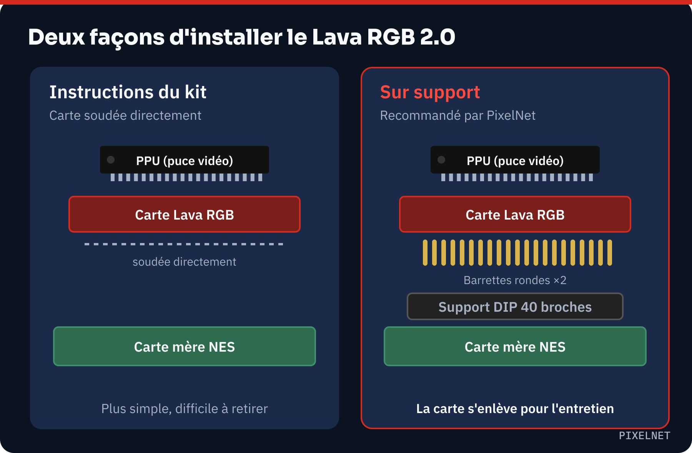
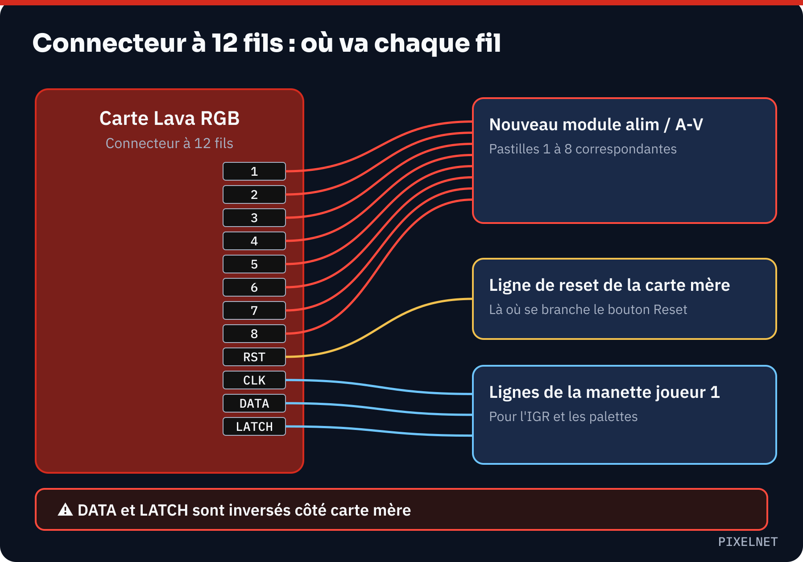
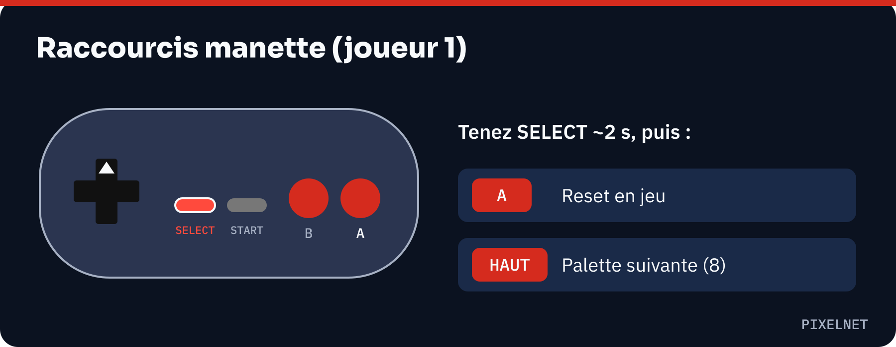

# NES : installer le Lava RGB 2.0

D'origine, la NES à chargement frontal ne sort que du composite et du RF : une image floue et baveuse. La carte **Lava RGB 2.0** se branche directement sur la puce vidéo (PPU) et vous donne du **RGB, du S-Vidéo et un composite propre**, en plus de 8 palettes de couleurs et d'un reset en jeu.

!!! warning "Installation avancée"
    Il faut **retirer le PPU** (40 broches) et le **module d'alimentation/A-V d'origine** de la carte mère. Ça prend un bon outil de dessoudage et de la patience. Pas à l'aise ? PixelNet peut [l'installer pour vous](https://pixelnet.ca/fr/products/lava-rgb-nes).

!!! info "Sources"
    Ce guide s'appuie sur les instructions fournies avec le kit et sur un [journal d'installation public détaillé](https://amaiorano.io/2025/09/03/lava-rgb.html){ target=_blank } (en anglais, carte NES-CPU-10). Les schémas de cette page sont des originaux de PixelNet.

!!! note "Photos à venir"
    Pour l'instant, ce guide utilise des schémas. **Avec le temps, on ajoutera nos propres photos**, prises pendant nos installations du Lava RGB 2.0, étape par étape.

## Ce que ça fait

- **RGB, S-Vidéo et composite** générés directement à partir du PPU : fini le flou du composite de la NES.
- **8 palettes** qu'on change à la manette.
- **Reset en jeu (IGR) :** on redémarre le jeu à la manette.
- Un **nouveau module d'alimentation/A-V** avec connecteur DIN (style Saturn) remplace le module d'origine.

## Compatibilité

| Console | Compatible | Note |
|---|---|---|
| **NES-001** (chargement frontal, NTSC) | ✅ | Ce guide |
| **Famicom / AV Famicom** | ✅ | Installation différente : suivez les instructions du kit |
| NES-101 (chargement par le haut) | ⚠️ | Pas couvert ici |

La révision de la carte mère est imprimée sur la carte (par exemple **NES-CPU-10**).

## Ce qu'il vous faut

**Le kit (Lava RGB 2.0, « NES senior VER 2.0 ») :**

- La carte Lava RGB
- Le module d'alimentation/A-V de remplacement (avec connecteur DIN)
- Un connecteur à 12 fils
- Deux barrettes de 20 broches (broches carrées)

**À acheter à part :**

- Un **support DIP 40 broches** (si vous voulez une carte amovible, recommandé)
- **Deux barrettes de 20 broches tournées (rondes)** : elles tiennent beaucoup mieux dans le support que les carrées du kit
- Un **kit de condensateurs NES-001** (recommandé : les condensateurs ont plus de 35 ans)
- *Optionnel :* une résistance de **47 kΩ** pour l'audio d'extension
- *Optionnel :* un connecteur multi-out SNES + nappe 8 fils, si vous préférez un câble RGB de SNES au DIN

**Outils :** fer à souder, flux, **pistolet à dessouder** (ou une bonne pompe), tresse à dessouder, pince coupante à ras, multimètre.

## Deux méthodes d'installation

| Méthode | Comment | Pour / contre |
|---|---|---|
| **Instructions du kit** | Carte Lava soudée **directement** sur la carte mère | Plus simple, mais difficile à retirer plus tard |
| **Sur support** (recommandation PixelNet) | Support sur la carte mère, PPU soudé **sur la carte Lava** | La carte s'enlève pour l'entretien; demande des barrettes rondes |

{ .pn-diagram }

Les étapes ci-dessous suivent la méthode **sur support**.

## Étapes

### 1. Ouvrir la console et sortir la carte mère

Retirez les vis du boîtier, le connecteur de cartouche (le « connecteur 72 broches ») et sortez la carte mère. Notez sa révision.

### 2. Retirer le PPU

Le PPU, c'est la puce vidéo de 40 broches. Ajoutez de la soudure fraîche et du flux sur chaque broche, puis videz chaque broche au pistolet à dessouder. Les broches sur le grand **plan de masse** gardent la chaleur : remettez de la soudure, attendez, dessoudez de nouveau. Quand toutes les broches bougent librement, sortez le PPU sans forcer.

### 3. Retirer le module d'alimentation/A-V d'origine

1. Mettez du flux sur les **4 grosses pattes d'ancrage** du boîtier métallique et enlevez la soudure (pistolet, puis tresse).
2. Retirez le couvercle métallique du module.
3. Par l'intérieur, dessoudez les **5 broches** du module.
4. Dégagez le module en le basculant doucement. **Les 5 broches restent sur la carte mère** : le nouveau module se soude dessus.

### 4. Coucher les condensateurs

Trois condensateurs de la carte mère sont trop hauts : la carte Lava ne passe pas par-dessus. Remplacez-les (kit de condensateurs) et **couchez-les à plat** avant de souder. Même capacité, tension égale ou supérieure, attention à la polarité.

### 5. Préparer la carte Lava

1. Soudez le **support 40 broches** à la place du PPU, **encoche du même côté** que la puce d'origine.
2. Enfoncez les deux **barrettes rondes** dans le support, longues broches vers le bas.
3. Posez la carte Lava par-dessus, broches dans les bons trous, et soudez.
4. Sortez doucement la carte du support en la basculant (les broches rondes plient facilement).
5. Coupez à ras les broches qui se retrouveraient sous le PPU.
6. Soudez le **PPU sur la carte Lava**, encoche alignée avec le marquage de la carte.

### 6. Brancher le connecteur à 12 fils

| Fils | Vont vers |
|---|---|
| **1 à 8** | Les pastilles correspondantes du **nouveau module d'alimentation/A-V** (même ordre que les marquages des deux cartes) |
| **RST** | La **ligne de reset** de la carte mère (là où se branche le bouton Reset) |
| **CLK, DATA, LATCH** | Les lignes de la **manette du joueur 1** (pour l'IGR et les palettes) |

{ .pn-diagram }

!!! warning "DATA et LATCH"
    Côté carte mère, **DATA et LATCH sont inversés** par rapport à leur ordre sur la carte Lava. Vérifiez chaque fil au multimètre avec le schéma du kit avant de souder.

### 7. Installer le nouveau module d'alimentation/A-V

1. Soudez un fil **GND** du module au plan de masse de la carte mère.
2. Faites un essai à blanc, puis soudez le module sur les **5 broches** restées sur la carte mère.
3. Branchez le **5 V** sur la pastille **PV** du module et l'**audio** sur la pastille **PA**.
4. Optionnel : branchez la nappe 8 fils sur un connecteur multi-out de SNES.

### 8. Premier test (avant de refermer)

Remettez la carte Lava dans le support et faites passer les fils vers le bas et sur le côté. Branchez l'alimentation et la manette, testez le **composite + l'audio**, puis le **RGB** avec le bon câble.

### 9. Optionnel : audio d'extension

Pour entendre l'audio d'extension (jeux Famicom avec adaptateur, certaines cartouches flash) : soudez une **résistance de 47 kΩ entre les broches 3 et 9** du port d'extension, sous la console.

### 10. Refermer la console

- Remettez le connecteur de cartouche et la carte mère, avec soin : **le nouveau module ne tient que par ses 5 broches**.
- **Laissez le blindage RF de côté** : il écraserait les fils du reset et de la manette.
- Revissez le boîtier.

## Utilisation

{ .pn-diagram }

| Action | Manette (joueur 1) |
|---|---|
| **Reset en jeu** | Tenez **Select** ~2 s, puis **A** |
| **Changer de palette** | Tenez **Select** ~2 s, puis **Haut**. Le nom de la palette s'affiche à l'écran |

## Dépannage

| Problème | Solution |
|---|---|
| Une broche du PPU ne sort pas | Remettez soudure + flux, dessoudez encore. Ne tirez jamais |
| Écran gris ou noir | Vérifiez l'orientation du PPU et les broches du support. Testez chaque fil au multimètre |
| L'IGR ne marche pas | Vérifiez le fil **RST** et l'ordre **DATA / LATCH** |
| Il manque une couleur (souvent le vert) | Essayez un autre câble RGB avant d'accuser l'installation |
| Pas d'audio d'extension | Une seule résistance de 47 kΩ entre les **broches 3 et 9**, rien d'autre |

[Service d'installation Lava RGB :material-cart:](https://pixelnet.ca/fr/products/lava-rgb-nes){ .md-button .md-button--primary }

Des questions : [support@pixelnet.ca](mailto:support@pixelnet.ca)
