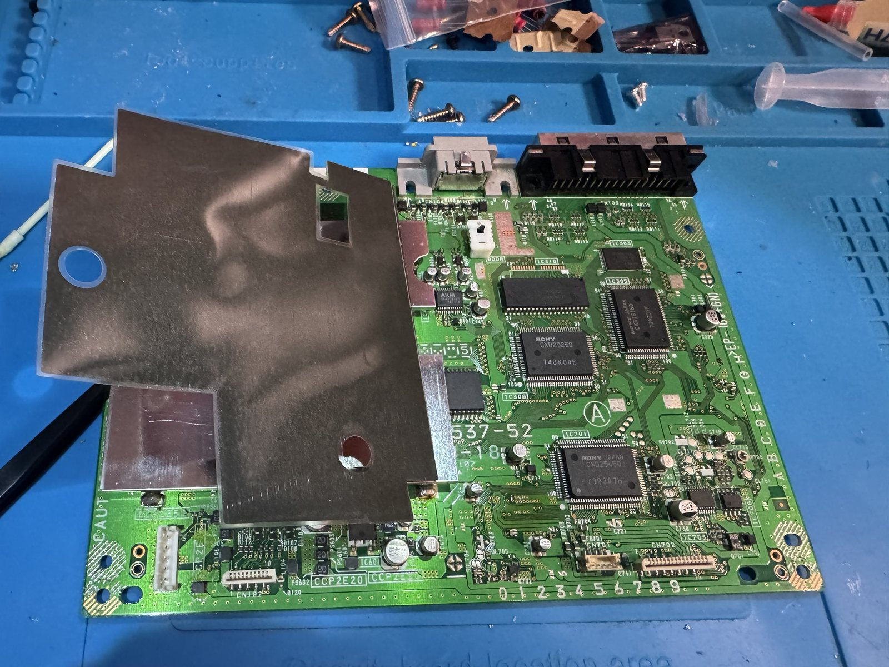
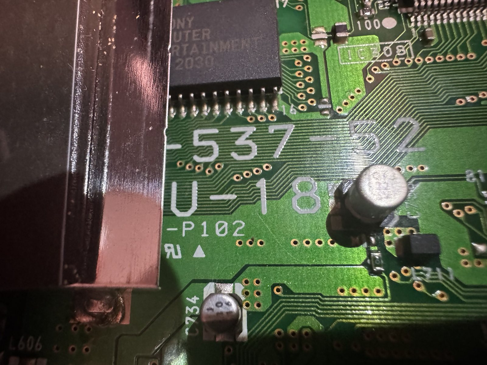
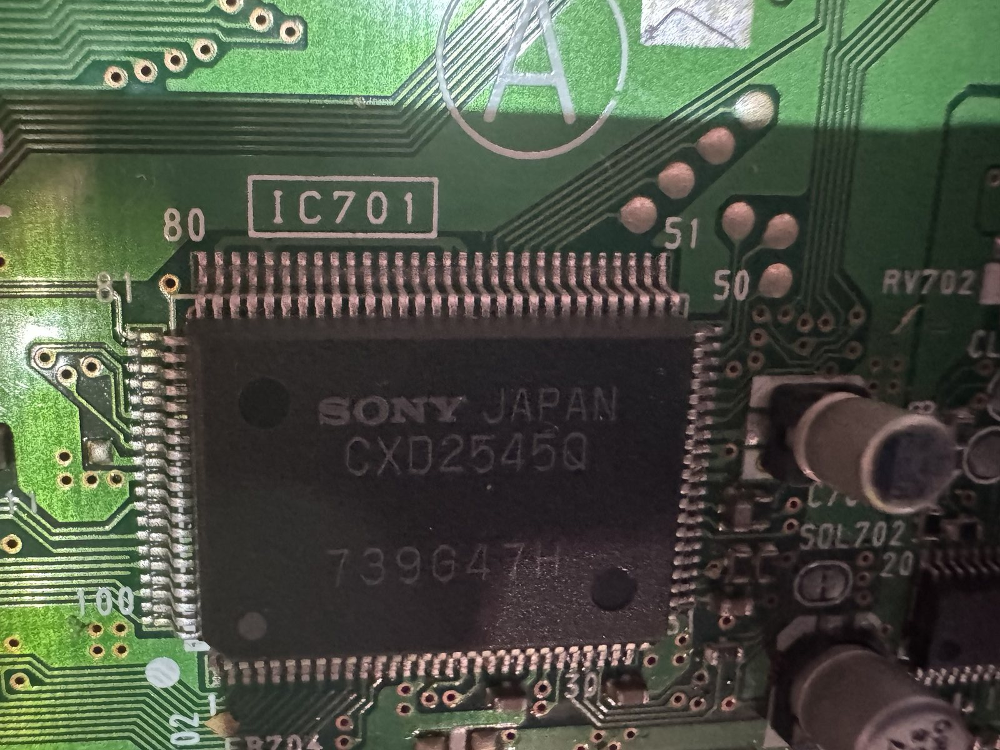
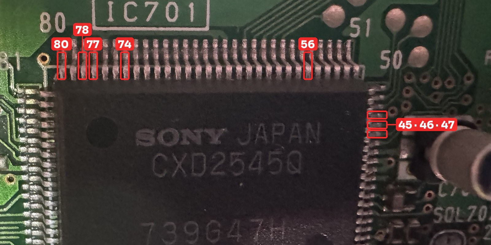
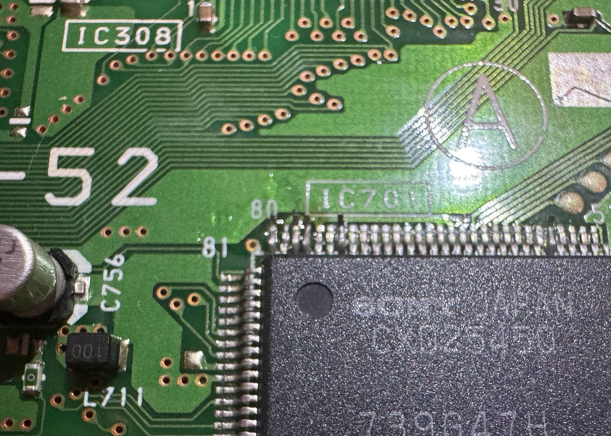
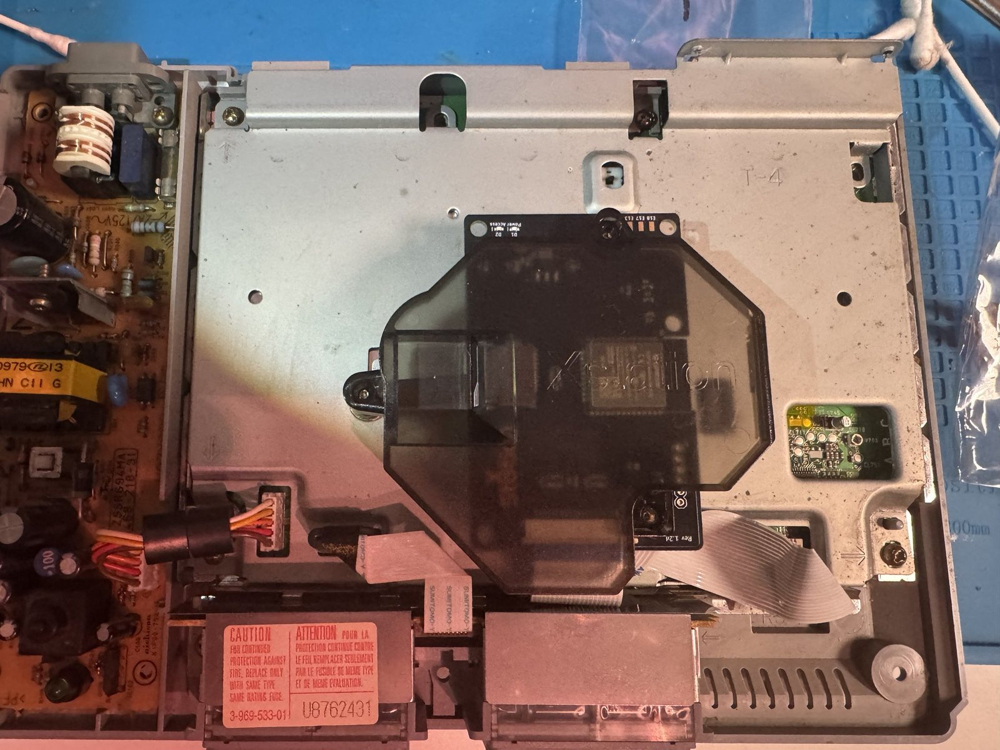
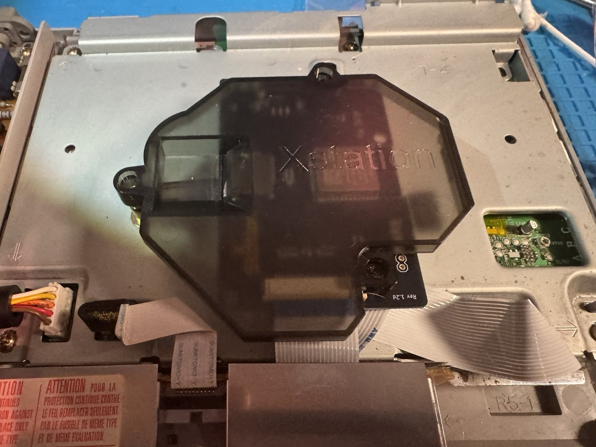

# PlayStation : installer le XStation (carte PU-18)

Le **XStation** est un émulateur de lecteur optique (ODE) : il prend la place du lecteur de disque de la PlayStation, et les jeux se lancent à partir d'une **carte microSD**. Chargements plus rapides, fini le laser usé, et toute votre collection dans une seule console.

!!! warning "Ce guide est pour les cartes PU-18 seulement"
    L'installation change selon la **révision de la carte mère**. Sur une **PU-18**, il y a une étape de plus que les autres cartes n'ont pas : il faut **soulever 8 pattes** de la puce Sony **CXD2545Q** (IC701). Sur une PU-8, suivez le guide XStation pour cette carte. Les PU-20, PU-22, PU-23 et la PSone (PM-41) **ne sont pas compatibles**.

## Compatibilité

| Carte | Modèles typiques | XStation |
|---|---|---|
| **PU-18** | Toutes les SCPH-5xxx (5501, 5001…), très rarement SCPH-7001 à 7003 | ✅ Ce guide |
| **PU-8** (early ou late) | SCPH-100x, la plupart des SCPH-3xxx | ✅ Autre guide (étapes différentes) |
| **PU-20**, **PU-22**, **PU-23** | La plupart des SCPH-7xxx, SCPH-750x, SCPH-900x | ❌ |
| **PM-41** | PSone (SCPH-10x) | ❌ |

## Trouver votre carte

Ouvrez la console : la révision (**PU-18**, **PU-8**…) est imprimée sur la carte mère. Le numéro de modèle (SCPH-…) sur l'étiquette sous la console donne un bon premier indice, mais seule la carte elle-même est certaine.

{ .pn-photo }

{ .pn-photo }

## Ce qu'il vous faut

- La trousse **XStation** : carte principale, **QSB** (Quick Solder Board) pour PU-18, nappe et entretoises
- Un fer à souder à pointe fine avec contrôle de température, du flux, de la soudure fine et de la tresse à dessouder
- Une **aiguille fine** ou un couteau de précision (X-Acto) pour soulever les pattes
- Du **grossissement** (loupe, casque-loupe ou microscope) : les pattes d'IC701 sont minuscules
- Un multimètre, des pinces fines, de l'alcool isopropylique
- Une carte microSD pour vos jeux

## Étapes

!!! danger "Avant de commencer"
    Débranchez le cordon d'alimentation et **retirez tous les câbles du bloc d'alimentation**. Il faut démonter complètement la PlayStation pour atteindre la carte mère.

### 1. Trouver IC701 (CXD2545Q)

Sur le **dessus** de la carte mère, trouvez **IC701**, la puce Sony marquée **CXD2545Q**, dans le coin inférieur droit.

{ .pn-photo }

### 2. Soulever 8 pattes d'IC701

C'est l'étape délicate. Soulevez **seulement** ces pattes : **45, 46, 47, 56, 74, 77, 78 et 80**.

{ .pn-photo }

Les numéros des pattes sont imprimés aux coins de la puce. La rangée du haut va de **80** (à gauche) à **51** (à droite), et le côté droit de **50** (en haut) vers le bas. Comptez à partir de ces coins : 80, 78, 77 et 74 sont les 1re, 3e, 4e et 7e pattes à partir de la gauche de la rangée du haut; 56 est la 6e à partir de la droite; 47, 46 et 45 sont les 4e, 5e et 6e pattes en descendant le côté droit.

Pour chaque patte : un peu de flux, touchez la patte avec la pointe du fer pour faire fondre la soudure, puis soulevez-la **doucement** par en dessous avec l'aiguille ou la lame. Une patte à la fois, sous grossissement. Tourner la carte peut vous donner un meilleur angle.

{ .pn-photo }

!!! tip "Vérifiez chaque patte"
    Chaque patte soulevée doit être **complètement** libre : aucun contact avec son pad ni avec la carte. Vérifiez-les une par une sous grossissement (et au multimètre en cas de doute). Ne soulevez aucune autre patte.

### 3. Préparer le dessous pour la QSB

Retournez la carte **à l'envers**. La QSB va dans la zone indiquée dans le guide XStation. Avant de souder, **grattez légèrement** les pads de via à gauche et à droite de cette zone pour que la soudure prenne bien.

### 4. Souder la QSB

Placez la QSB sur ses pads (les repères sur la QSB aident à l'aligner) et soudez-la.

### 5. Retirer la résistance et brancher APLL

Dessoudez et retirez la **petite résistance à côté de l'oscillateur** marqué **V67.737 KDS** (voir le guide officiel pour sa position exacte). Branchez ensuite le pad **APLL** de la QSB au point indiqué juste au-dessus de la résistance retirée.

### 6. Préparer le boîtier

Sur la **moitié du bas** du boîtier, coupez le **petit tenon de plastique** indiqué dans le guide XStation. Sinon, la nappe peut se briser à la fermeture de la console.

### 7. Brancher et faire passer la nappe

Branchez la nappe dans le connecteur de la QSB, **côté bleu vers le haut**, et refermez le loquet. Faites sortir la nappe par la **fente du blindage du dessus**.

### 8. Fixer le XStation

Enfoncez les **3 entretoises** dans la carte XStation (coins inférieur droit, supérieur droit et supérieur gauche, vu de dessus). Branchez l'autre bout de la nappe au XStation, pliez-la comme dans le guide, puis fixez le XStation sur les **poteaux du lecteur d'origine**.

{ .pn-photo }

{ .pn-photo }

### 9. Tester avant de fermer

Remontez la console juste assez pour l'allumer, préparez la carte microSD (voir [la section suivante](#preparer-la-carte-microsd-et-le-loader)), et vérifiez que le menu du XStation s'affiche et qu'un jeu démarre. Remontez ensuite la PlayStation au complet.

## Préparer la carte microSD et le loader

Le XStation a besoin de ses fichiers système sur la carte microSD pour lancer son menu (le **loader**) et mettre à jour son firmware.

### 1. Formater la carte

Formatez la carte microSD avec le **SD Memory Card Formatter** de la SD Association. Il choisit lui-même le bon système de fichiers (FAT32 jusqu'à 32 Go, exFAT au-delà) avec le bon alignement, ce qui évite la plupart des problèmes de « carte non détectée ».

### 2. Copier les fichiers du XStation

1. Téléchargez le dernier firmware sur la [page des versions XStation :material-open-in-new:](https://github.com/x-station/xstation-releases/releases){ target=_blank }.
2. À la **racine** de la carte, créez un dossier nommé exactement **`00xstation`**.
3. Extrayez **`update.bin`** et **`loader.bin`** du téléchargement dans ce dossier `00xstation`.

!!! info "Firmware récent"
    Depuis le firmware 2.0.2, le loader est intégré au XStation : la console peut lancer le menu même sans `loader.bin`. Le fichier est toujours fourni, alors gardez-le dans le dossier.

### 3. Ajouter vos jeux

Copiez vos images de disque (**.bin + .cue**, idéalement au format Redump) à la racine de la carte ou dans des sous-dossiers, par exemple un dossier par jeu. Gardez les fichiers `.bin` et leur `.cue` ensemble.

### 4. Premier démarrage et mise à jour du firmware

1. Insérez la carte, **fermez le couvercle** (ou tenez l'interrupteur du couvercle enfoncé si le dessus du boîtier est retiré) et allumez la console.
2. Le menu du XStation (le loader) apparaît. S'il ne démarre pas tout seul, **tenez Reset enfoncé environ une seconde**.
3. Ouvrez le menu des **options**, choisissez **Update Firmware**, puis appuyez sur **Start**.
4. Le firmware s'installe et la console redémarre toute seule. Vous pouvez vérifier la nouvelle version dans le menu des options.

!!! tip "Navigation par dossiers"
    Dans les options du loader, vous pouvez activer la **navigation par dossiers** : les jeux s'affichent par dossier, sans balayer toute la carte d'abord. Pratique avec une grosse collection.

### Si le loader ne démarre pas

- **Vous arrivez sur l'écran Memory Card / CD Player :** la console croit que le couvercle est ouvert. Sans le lecteur d'origine, le couvercle n'appuie parfois plus sur l'interrupteur. Tenez l'interrupteur enfoncé en allumant; si le menu apparaît, ajoutez une petite cale pour que le couvercle l'enfonce bien.
- **La carte n'est pas détectée :** réinsérez-la à fond, essayez une autre carte formatée comme plus haut, et vérifiez que `00xstation` est bien à la racine de la carte (pas dans un autre dossier).
- **Toujours rien :** revérifiez l'installation : chaque soudure de la QSB (au multimètre), les 8 pattes soulevées d'IC701 (aucune ne touche son pad) et la nappe (bien enfoncée, côté bleu vers le haut sur la QSB).

## Guide officiel XStation

Les étapes ci-dessus résument le guide officiel, qui a une photo pour chaque étape (position des pattes, emplacement de la QSB, résistance à retirer). Gardez-le ouvert pendant l'installation. Il est en anglais.

[Guide officiel XStation PU-18 :material-open-in-new:](https://github.com/x-station/xstation-releases/wiki/xStation-ODE-installation-guide-for-the-PU-18-Playstation-1-motherboard){ .md-button target=_blank }

## Résultat

Votre PlayStation démarre sur le menu du XStation, et chaque jeu se lance à partir de la carte microSD. Le lecteur de disque d'origine n'est plus nécessaire : gardez-le en lieu sûr si jamais vous voulez revenir en arrière.

Pas à l'aise de soulever des pattes de puce ? PixelNet peut [l'installer pour vous](https://pixelnet.ca/collections/installation). Questions : [support@pixelnet.ca](mailto:support@pixelnet.ca)
