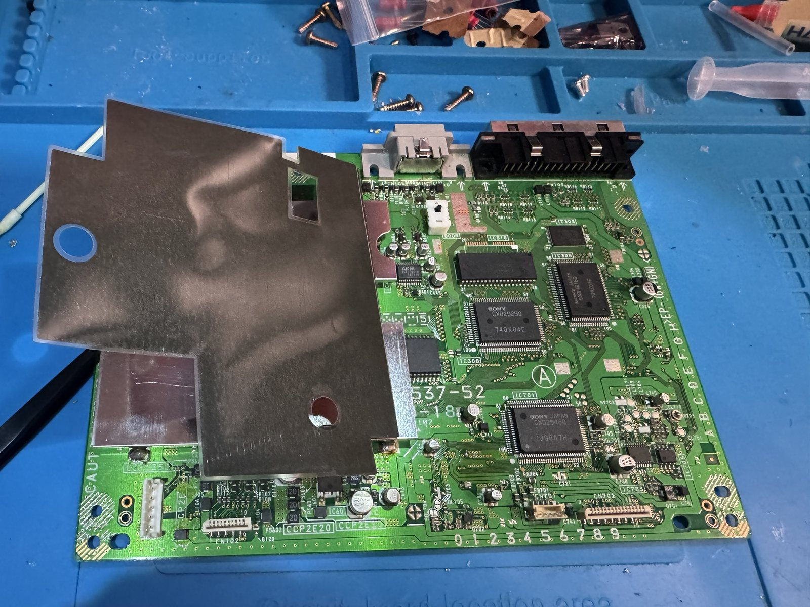
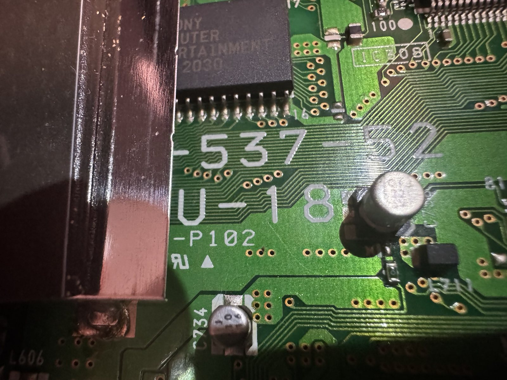
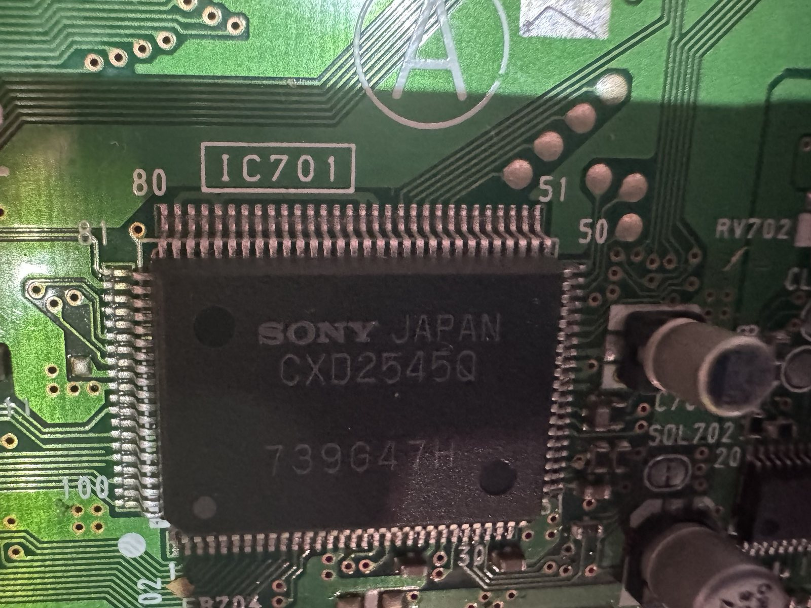
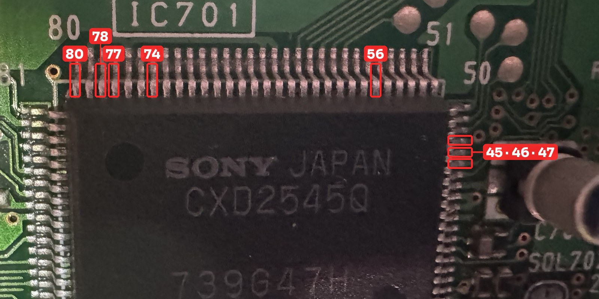
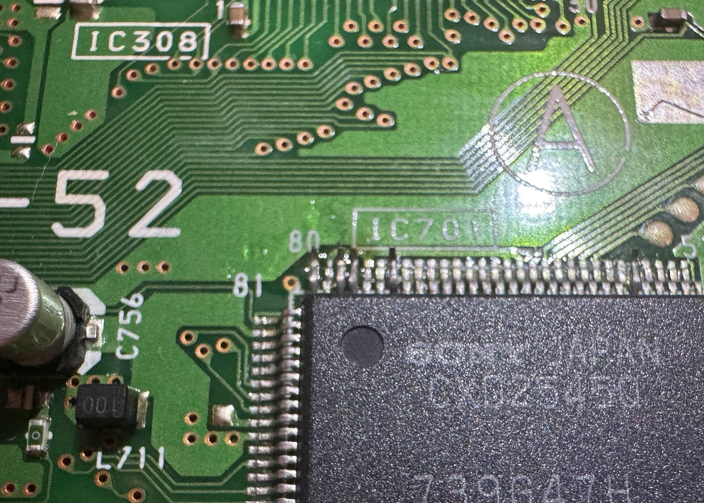
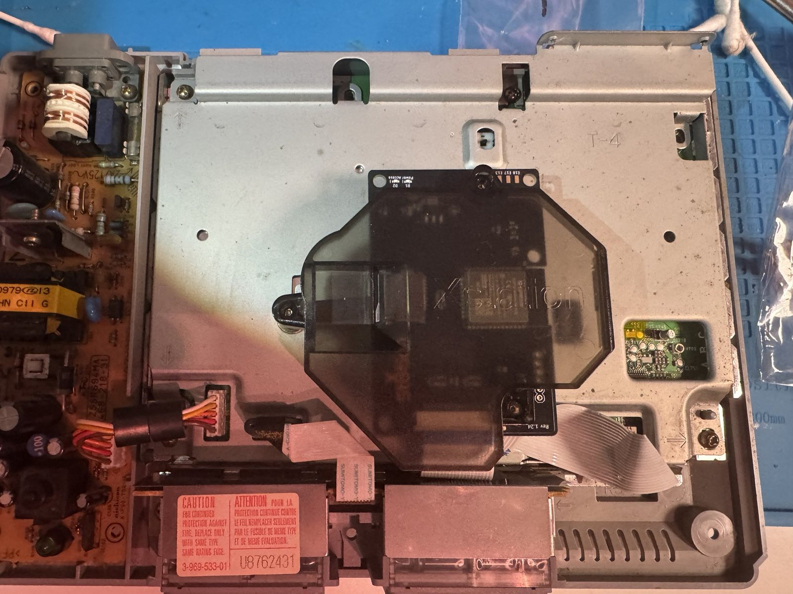
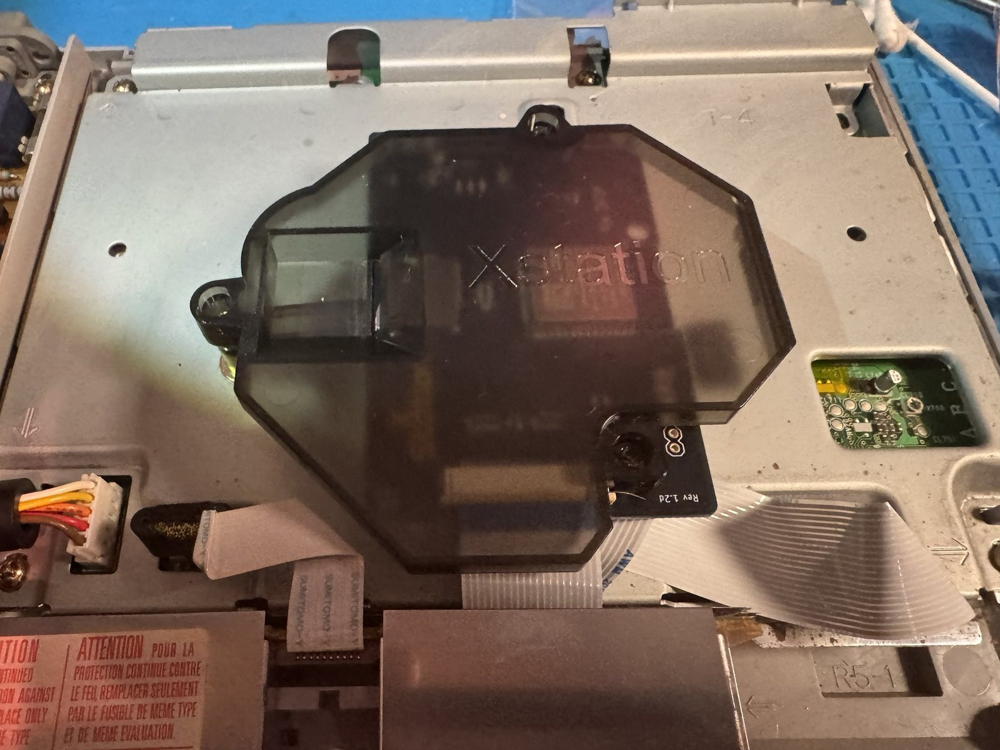

# PlayStation: installing the XStation (PU-18 board)

The **XStation** is an optical drive emulator (ODE): it takes the place of the PlayStation's disc drive, and games load from a **microSD card**. Faster loading, no more worn-out laser, and your whole library in one console.

!!! warning "This guide is for PU-18 boards only"
    The install changes with the **motherboard revision**. On a **PU-18**, there's an extra step that other boards don't need: you have to **lift 8 legs** of the Sony **CXD2545Q** chip (IC701). On a PU-8, follow the XStation guide for that board. PU-20, PU-22, PU-23 and the PSone (PM-41) are **not compatible**.

## Compatibility

| Board | Typical models | XStation |
|---|---|---|
| **PU-18** | All SCPH-5xxx (5501, 5001…), very rarely SCPH-7001 to 7003 | ✅ This guide |
| **PU-8** (early or late) | SCPH-100x, most SCPH-3xxx | ✅ Other guide (different steps) |
| **PU-20**, **PU-22**, **PU-23** | Most SCPH-7xxx, SCPH-750x, SCPH-900x | ❌ |
| **PM-41** | PSone (SCPH-10x) | ❌ |

## Identify your board

Open the console: the revision (**PU-18**, **PU-8**…) is printed on the motherboard. The model number (SCPH-…) on the label under the console gives a good first hint, but only the board itself is certain.

{ .pn-photo }

{ .pn-photo }

## What you need

- The **XStation** kit: main board, **QSB** (Quick Solder Board) for PU-18, flex cable and spacers
- A fine-tip, temperature-controlled soldering iron, flux, fine solder and solder wick
- A **fine needle** or a hobby knife (X-Acto) to lift the legs
- **Magnification** (loupe, headset or microscope): the IC701 legs are tiny
- A multimeter, tweezers, isopropyl alcohol
- A microSD card for your games

## Steps

!!! danger "Before you start"
    Unplug the power cord and **disconnect every cable from the power supply**. You have to take the PlayStation apart completely to reach the motherboard.

### 1. Find IC701 (CXD2545Q)

On the **top side** of the motherboard, find **IC701**, the Sony chip marked **CXD2545Q**, in the lower right corner.

{ .pn-photo }

### 2. Lift 8 legs of IC701

This is the delicate part. Lift **only** these legs: **45, 46, 47, 56, 74, 77, 78 and 80**.

{ .pn-photo }

Pin numbers are printed at the chip's corners. The top row goes from **80** (left) to **51** (right), and the right side from **50** (top) down. Count from those corners: 80, 78, 77 and 74 are the 1st, 3rd, 4th and 7th legs from the left of the top row; 56 is the 6th from the right; 47, 46 and 45 are the 4th, 5th and 6th legs down the right side.

For each leg: add a little flux, touch the leg with the soldering tip to melt the solder, and **gently** lift it from underneath with the needle or blade. Work one leg at a time, under magnification. Turning the board around can give you a better angle.

{ .pn-photo }

!!! tip "Check every leg"
    Each lifted leg must be **completely** free: no contact with its pad or the board. Check them one by one under magnification (and with the multimeter if in doubt). Lift no other legs.

### 3. Prepare the underside for the QSB

Turn the board **bottom side up**. The QSB goes in the area shown in the XStation guide. Before soldering, **lightly scratch** the via pads on the left and right of that area so solder takes properly.

### 4. Solder the QSB

Place the QSB on its pads (the markings on the QSB help with alignment) and solder it.

### 5. Remove the resistor and connect APLL

Desolder and remove the **small resistor next to the oscillator** marked **V67.737 KDS** (see the official guide for its exact position). Then connect the QSB's **APLL** pad to the point shown just above the removed resistor.

### 6. Prepare the case

On the **bottom half** of the case, cut off the **small plastic pin** marked in the XStation guide. If you skip it, the flex cable can break when you close the console.

### 7. Connect and route the flex cable

Plug the flex cable into the QSB connector, **blue side up**, and close the latch. Route the cable out through the **slot in the top shield**.

### 8. Mount the XStation

Push the **3 spacers** into the XStation board (lower right, upper right and upper left corners, seen from above). Connect the other end of the flex cable to the XStation, fold it as shown in the guide, then mount the XStation on the **posts of the original disc drive**.

{ .pn-photo }

{ .pn-photo }

### 9. Test before closing

Put the console back together far enough to power it on, prepare the microSD card (see [the next section](#set-up-the-microsd-card-and-the-loader)), and check that the XStation menu appears and a game starts. Then reassemble the PlayStation.

## Set up the microSD card and the loader

The XStation needs its system files on the microSD card to start its menu (the **loader**) and to update its firmware.

### 1. Format the card

Format the microSD card with the **SD Memory Card Formatter** from the SD Association. It picks the right file system on its own (FAT32 up to 32 GB, exFAT above) with proper alignment, which avoids most "card not detected" problems.

### 2. Copy the XStation files

1. Download the latest firmware from the [XStation releases page :material-open-in-new:](https://github.com/x-station/xstation-releases/releases){ target=_blank }.
2. At the **root** of the card, create a folder named exactly **`00xstation`**.
3. Extract **`update.bin`** and **`loader.bin`** from the download into that `00xstation` folder.

!!! info "Recent firmware"
    Since firmware 2.0.2, the loader is built into the XStation itself: the console can start the menu even without `loader.bin`. The file is still included, so keep it in the folder.

### 3. Add your games

Copy your disc images (**.bin + .cue**, ideally Redump-format dumps) to the root of the card or into sub-folders, for example one folder per game. Keep the `.bin` files and their `.cue` together.

### 4. First start and firmware update

1. Insert the card, **close the lid** (or hold the lid switch down if the top shell is off) and power on.
2. The XStation menu (the loader) appears. If it doesn't start on its own, **hold Reset for about a second**.
3. Open the **options** menu, select **Update Firmware**, then press **Start**.
4. The firmware installs and the console reboots on its own. You can check the new version in the options menu.

!!! tip "Folder browsing"
    In the loader options you can turn on **folder-based browsing**: games are shown by folder, without scanning the whole card first. Handy with a big collection.

### If the loader doesn't start

- **You land on the Memory Card / CD Player screen:** the console thinks the lid is open. With the original drive gone, the lid sometimes no longer presses the switch. Hold the switch down while powering on; if the menu then appears, add a small spacer so the lid presses it properly.
- **The card isn't detected:** reseat it fully, try another card formatted as above, and check that `00xstation` is at the root of the card (not inside another folder).
- **Still nothing:** recheck the install: every QSB solder joint (with the multimeter), the 8 lifted IC701 legs (none touching its pad), and the flex cable (fully seated, blue side up on the QSB).

## Official XStation guide

The steps above summarize the official guide, which has a photo for every step (pin positions, QSB location, the resistor to remove). Keep it open during the install.

[Official XStation PU-18 guide :material-open-in-new:](https://github.com/x-station/xstation-releases/wiki/xStation-ODE-installation-guide-for-the-PU-18-Playstation-1-motherboard){ .md-button target=_blank }

## Result

Your PlayStation boots into the XStation menu, and every game loads from the microSD card. The original disc drive is no longer needed: keep it in a safe place in case you ever want to go back.

Not comfortable lifting chip legs? PixelNet can [install it for you](https://pixelnet.ca/collections/installation). Questions: [support@pixelnet.ca](mailto:support@pixelnet.ca)
