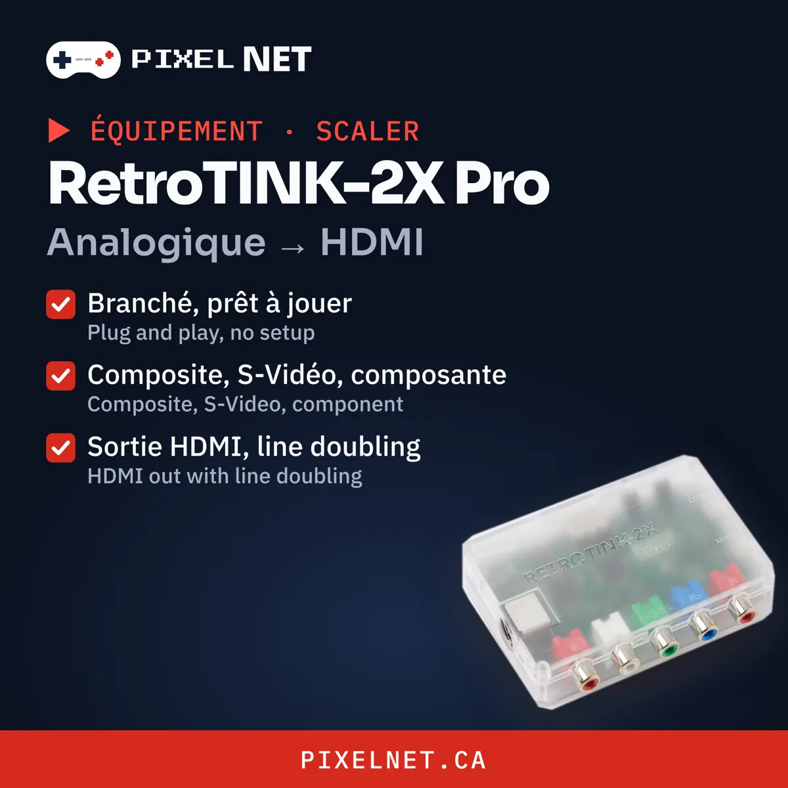

# Quel scaler choisir ?

Les télés modernes gèrent mal les vieux signaux analogiques : image floue, délai, ou pas d'image du tout. Un scaler convertit ce signal en HDMI propre.

## C'est quoi, un scaler ?

Les consoles rétro ont été conçues pour les télés cathodiques. Elles envoient un signal analogique basse résolution (240p) que les télés modernes comprennent mal. Ta télé essaie de le convertir elle-même, et elle le fait mal : image molle, mauvais format, et surtout du délai.

Un scaler prend le relais. Il lit le signal de la console, multiplie les lignes et envoie un HDMI propre et net à ta télé.

## Pourquoi c'est une excellente solution

- **Rien à ouvrir :** tu le branches entre la console et la télé. Ta console reste d'origine.
- **Aucun délai perceptible :** presque aucune latence, contrairement au traitement de ta télé.
- **Une image beaucoup plus nette :** les pixels tels que les artistes les ont dessinés.
- **Un seul appareil pour plusieurs consoles :** NES, SNES, Genesis, N64, etc.
- **Le complément idéal d'un mod :** avec un mod RGB, tu obtiens la meilleure image possible.

## RetroTINK-2X Pro — le plus simple

{ .pn-photo }

Branché, prêt à jouer. Entrées composite, S-Vidéo et composante, sortie HDMI avec line doubling. Parfait pour une console d'origine.

[Acheter chez RetroTINK :material-open-in-new:](https://www.retrotink.com/shop/retrotink-2x-pro){ .md-button .md-button--primary target=_blank }

## OSSC — pour les puristes du RGB

Latence quasi nulle et image ultra nette à partir d'une source RGB, composante ou VGA. Le partenaire idéal d'une console moddée RGB.

[Acheter chez Videogame Perfection :material-open-in-new:](https://www.videogameperfection.com/products/open-source-converter/){ .md-button .md-button--primary target=_blank }

## Lequel choisir ?

| Ta console | Choix |
|---|---|
| D'origine, composite ou S-Vidéo | RetroTINK-2X Pro |
| Moddée RGB | OSSC |

Pas certain ? [support@pixelnet.ca](mailto:support@pixelnet.ca) — on peut aussi [installer le mod RGB](https://pixelnet.ca/fr/collections/installation) pour toi.
