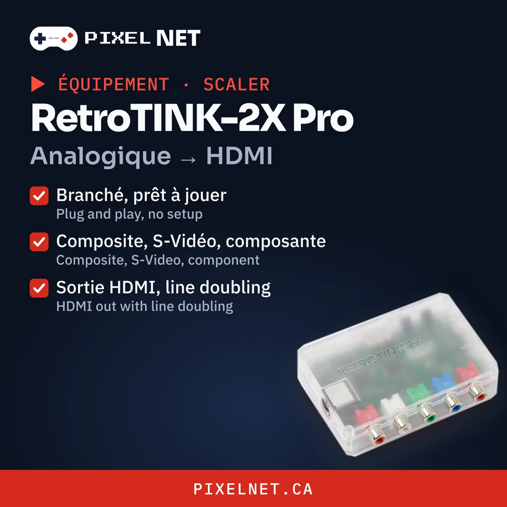

# Which scaler should you use?

Modern TVs don't handle old analog signals well: you get blur, lag, or no picture at all. A scaler converts that signal into clean HDMI.

## What is a scaler?

Retro consoles were designed for CRT TVs. They send a low-resolution analog signal (240p) that modern TVs don't understand well. Your TV tries to convert it by itself, and it does a poor job: soft picture, the wrong format, and above all lag.

A scaler takes over that conversion. It reads the console's signal, multiplies the lines, and sends clean, sharp HDMI to your TV.

## Why it's a great solution

- **Nothing to open:** plug it in between the console and the TV. Your console stays stock.
- **No noticeable lag:** almost no delay, unlike your TV's built-in processing.
- **A much sharper picture:** pixels the way the artists intended.
- **One device for several consoles:** NES, SNES, Genesis, N64 and more.
- **Pairs well with a mod:** with an RGB mod, you get the best possible picture.

## RetroTINK-2X Pro — the simple one

{ .pn-photo }

Plug and play. Composite, S-Video and component in, HDMI out with line doubling. Perfect for a stock console.

[Buy at RetroTINK :material-open-in-new:](https://www.retrotink.com/shop/retrotink-2x-pro){ .md-button .md-button--primary target=_blank }

## OSSC — for RGB purists

Ultra-low latency and razor-sharp picture from RGB, component or VGA. The ideal partner for an RGB-modded console.

[Buy at Videogame Perfection :material-open-in-new:](https://www.videogameperfection.com/products/open-source-converter/){ .md-button .md-button--primary target=_blank }

## Which one?

| Your console | Pick |
|---|---|
| Stock, composite or S-Video | RetroTINK-2X Pro |
| RGB-modded | OSSC |

Not sure? [support@pixelnet.ca](mailto:support@pixelnet.ca) — we can also [install the RGB mod](https://pixelnet.ca/collections/installation) for you.
