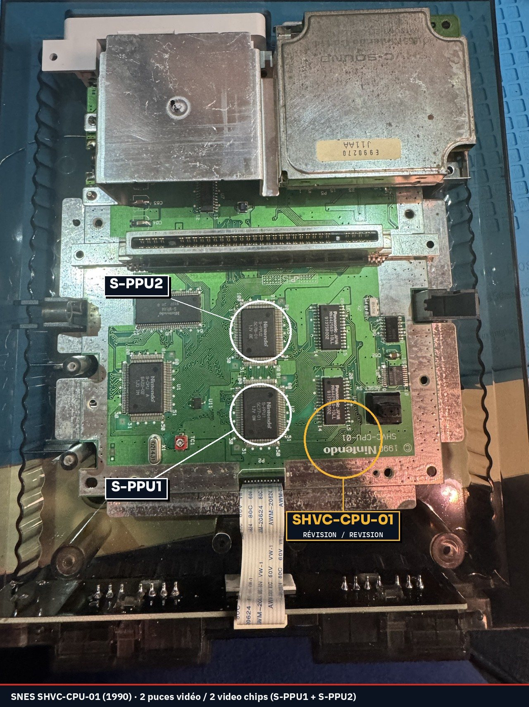
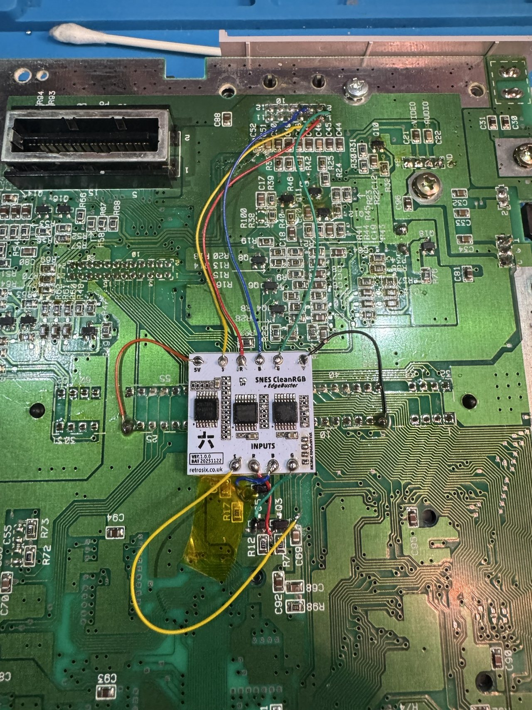
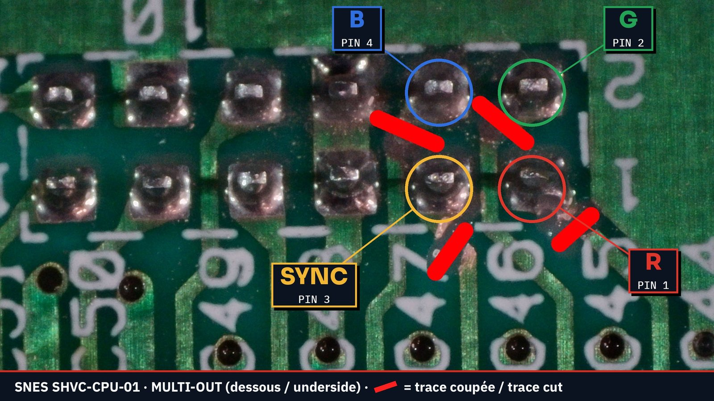
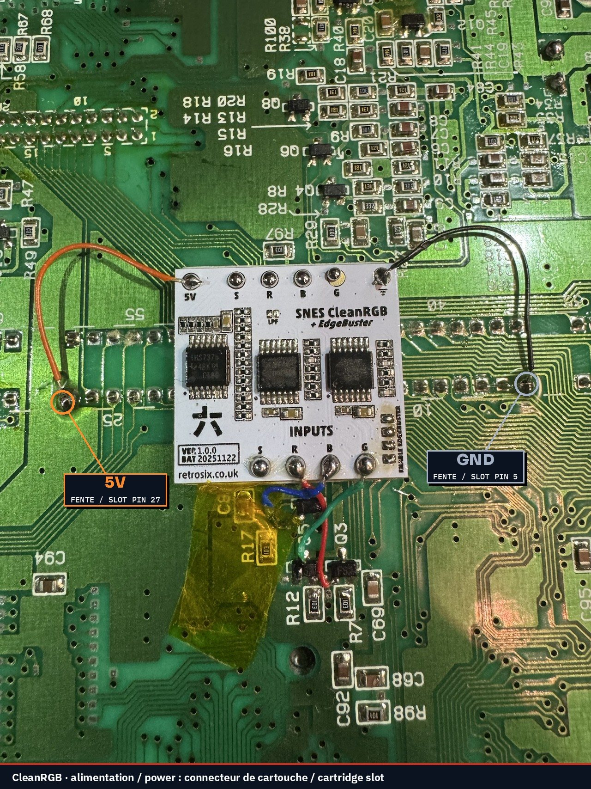
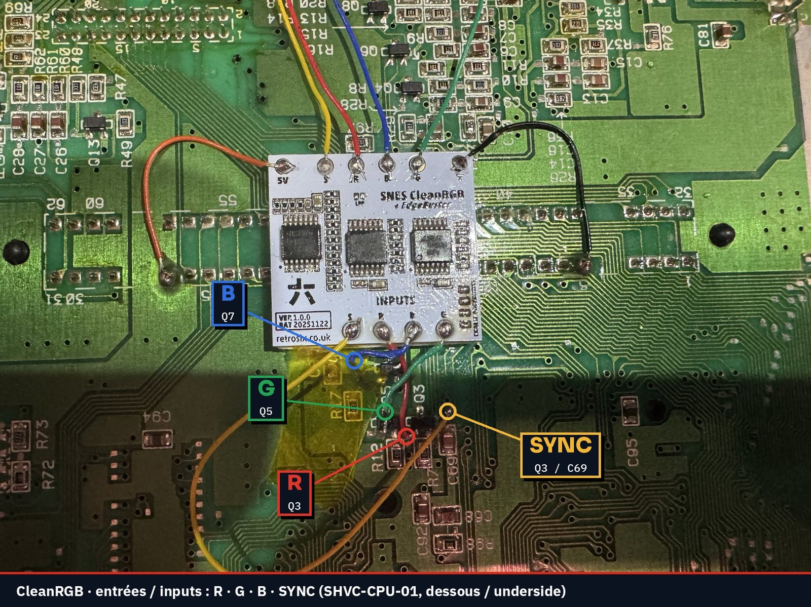
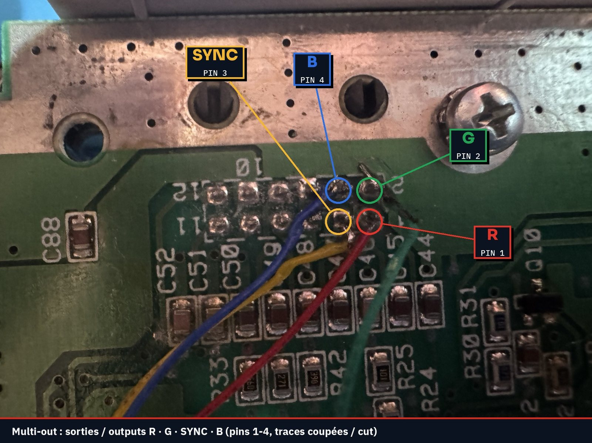
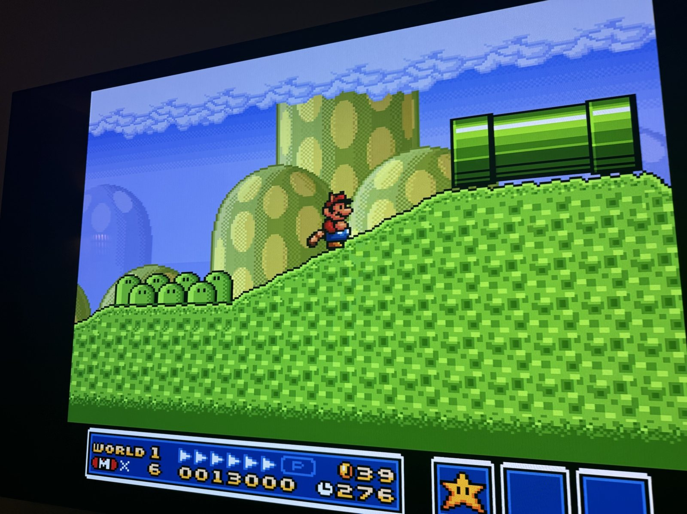

# SNES : installer le CleanRGB + EdgeBuster de RetroSix

La Super Nintendo d'origine est connue pour son image RGB un peu floue, avec des « fantômes » sur le bord des pixels. La carte **CleanRGB + EdgeBuster** de RetroSix règle les deux : on obtient l'image nette et stable que cette console mérite.

!!! warning "Vérifiez d'abord la révision de votre carte"
    Les points de soudure dépendent de la **révision de la carte mère** de votre SNES. Ce guide montre une carte **SHVC-CPU-01**, une des toutes premières (1990). Sur une autre révision, les numéros des composants (Q3, Q5, Q7…) ne sont pas les mêmes : suivez les instructions de RetroSix pour votre carte.

## Ce que ça fait

- **CleanRGB :** reconstruit correctement les signaux rouge, vert, bleu et sync : bons niveaux, équilibre des couleurs et filtrage du bruit.
- **EdgeBuster :** élimine les fantômes et les contours de pixels flous. La différence est la plus grande sur les cartes **2 puces** (deux puces vidéo séparées, S-PPU1 et S-PPU2), qui ont l'image la plus floue.

## Compatibilité

La carte CleanRGB + EdgeBuster fonctionne avec **toutes les révisions de SNES / Super Famicom**, 1 puce comme 2 puces. Ce qui change d'une révision à l'autre, c'est **où souder**.

| Type de carte | Révisions (exemples) | Compatible | Gain d'image |
|---|---|---|---|
| **2 puces** | SHVC-CPU-01, SNS-CPU-GPM-01/02, SNS-CPU-RGB-01/02, SNS-CPU-APU-01, SNSP-CPU-01/02 (PAL) | ✅ | Énorme : fini le flou et les fantômes |
| **1 puce** (1CHIP) | SNS-CPU-1CHIP-01/02/03, SNSP-CPU-1CHIP (PAL) | ✅ | Signal plus propre et plus stable |

## Trouver votre révision

Ouvrez la console : la révision est imprimée sur la carte mère, à côté du logo Nintendo et de l'année. Sur une carte 2 puces, on voit aussi **deux puces vidéo**, S-PPU1 et S-PPU2.

{ .pn-photo }

## Ce qu'il vous faut

- La carte **SNES CleanRGB + EdgeBuster** de RetroSix
- Du fil fin (30 AWG), du ruban Kapton, un couteau de précision
- Un fer à souder à pointe fine et un multimètre
- Un câble RGB avec **sync composite (csync)** pour tester

## Plan de câblage (SHVC-CPU-01)

Tout se fait sur le **dessous** de la carte mère.

| Pastille du CleanRGB | Va vers |
|---|---|
| **5V** | Fente de cartouche, **broche 27** |
| **GND** ⏚ | Fente de cartouche, **broche 5** |
| **Entrée R** | **Q3** (patte exacte : voir la photo des entrées) |
| **Entrée G** | **Q5** (patte exacte : voir la photo des entrées) |
| **Entrée B** | **Q7** (patte exacte : voir la photo des entrées) |
| **Entrée S** (sync) | Pastille entre **Q3 et C69** |
| **Sortie R** | Multi-out **broche 1** |
| **Sortie G** | Multi-out **broche 2** |
| **Sortie S** (csync) | Multi-out **broche 3** |
| **Sortie B** | Multi-out **broche 4** |

{ .pn-photo }

## Vidéo d'installation de RetroSix

La vidéo officielle de RetroSix montre l'installation étape par étape (en anglais). Servez-vous-en avec le plan ci-dessus.

<iframe src="https://www.youtube-nocookie.com/embed/JLM67N5JXhw" title="RetroSix SNES CleanRGB + EdgeBuster" style="position:absolute;inset:0;width:100%;height:100%;border:0" allow="accelerometer; encrypted-media; gyroscope; picture-in-picture" allowfullscreen></iframe>

[Voir sur YouTube :material-open-in-new:](https://www.youtube.com/watch?v=JLM67N5JXhw){ .md-button target=_blank }

## Étapes

### 1. Couper les traces du multi-out (broches 1 à 4)

Sous le connecteur multi-out, coupez la trace qui part de chacune des **broches 1, 2, 3 et 4**. On débranche ainsi le signal vidéo d'origine pour que seul le signal propre arrive au connecteur. Vérifiez au multimètre que chaque broche est bien isolée.

{ .pn-photo }

### 2. Placer la carte et l'alimenter

Mettez du ruban Kapton sous la carte pour que rien ne touche la carte mère. Branchez **5V** à la **broche 27** de la fente de cartouche et **GND** à la **broche 5**.

{ .pn-photo }

### 3. Câbler les entrées

Des fils courts de la rangée **INPUTS** vers Q3 (R), Q5 (G), Q7 (B) et le point de sync entre Q3 et C69. Soudez sur la **patte exacte encerclée sur la photo ci-dessous**.

{ .pn-photo }

### 4. Câbler les sorties vers le multi-out

De la rangée du haut de la carte (S, R, B, G) vers les pastilles du multi-out que vous avez isolées : **R → 1, G → 2, S → 3, B → 4**.

{ .pn-photo }

### 5. Activer l'EdgeBuster

Pontez les pastilles **ENABLE EDGEBUSTER** sur la carte, comme décrit dans les instructions de RetroSix.

### 6. Tester avant de refermer

Branchez un câble RGB avec **csync**, lancez un jeu et vérifiez l'image avant de remettre la coque.

## Résultat

{ .pn-photo }

[Acheter le CleanRGB + EdgeBuster :material-cart:](https://pixelnet.ca/products/cleanrgb-edgebuster-retrosix-super-nintendo){ .md-button .md-button--primary }

Pas à l'aise avec la soudure ? PixelNet peut [l'installer pour vous](https://pixelnet.ca/collections/installation). Questions : [support@pixelnet.ca](mailto:support@pixelnet.ca)
