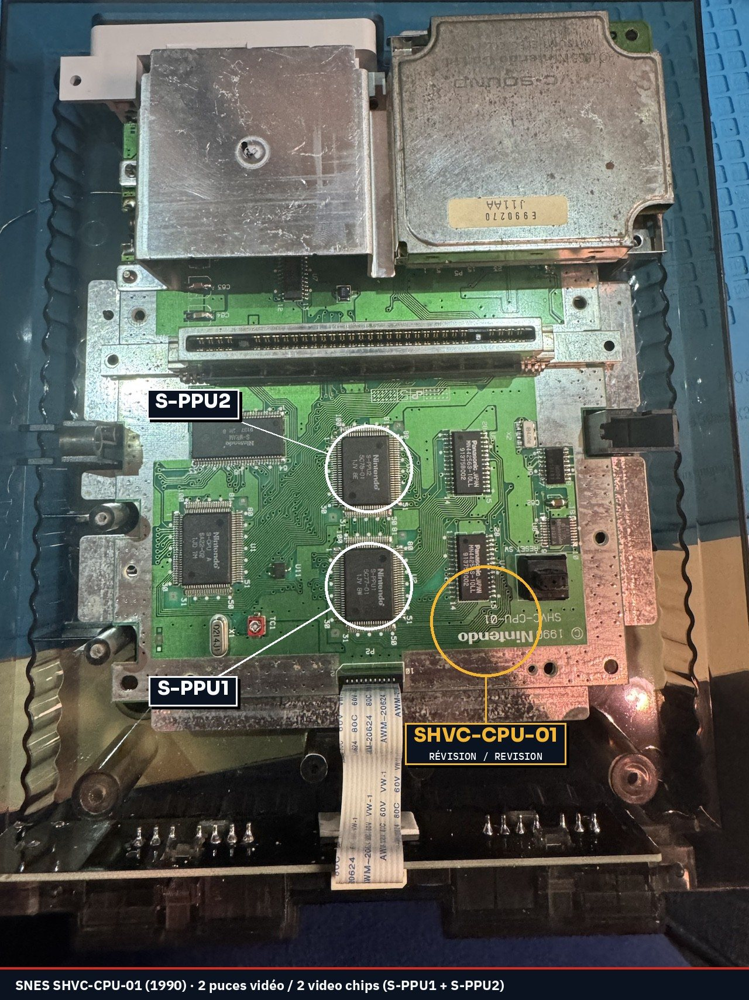
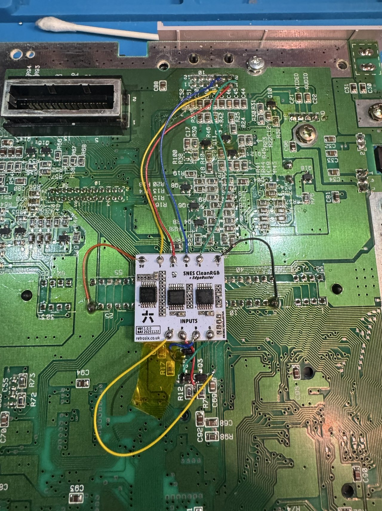
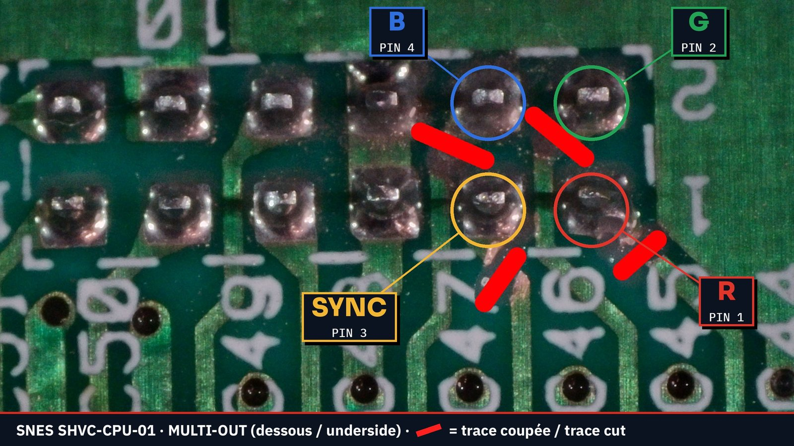
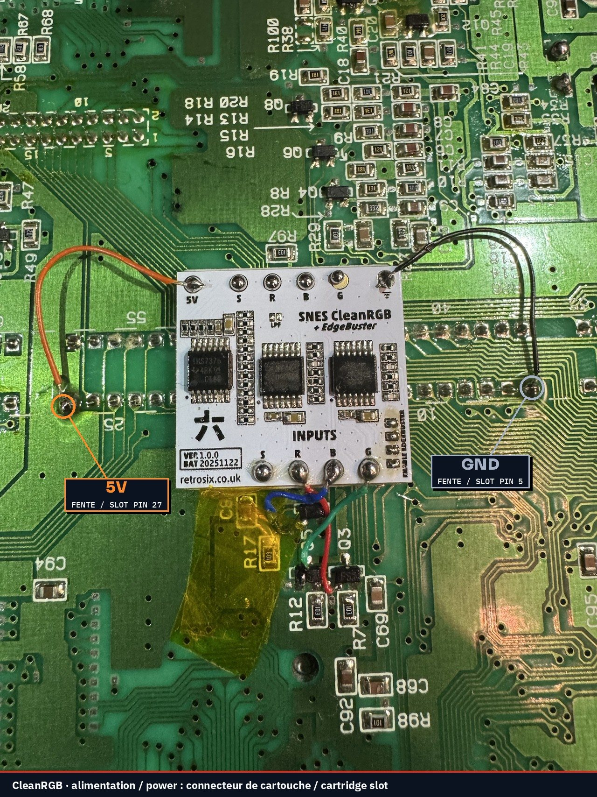
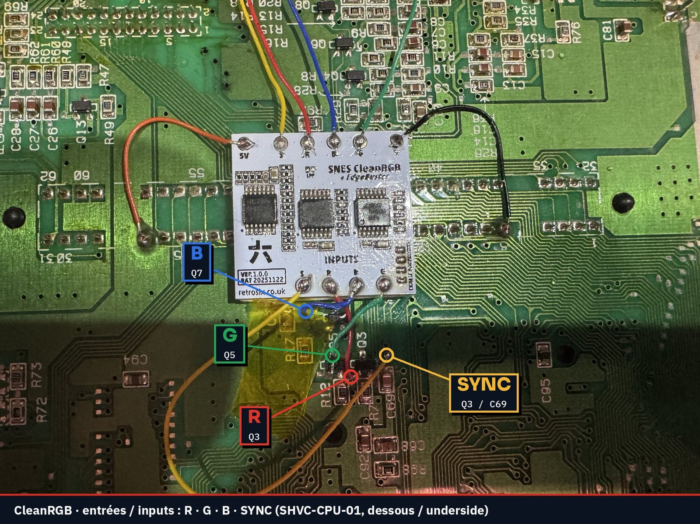
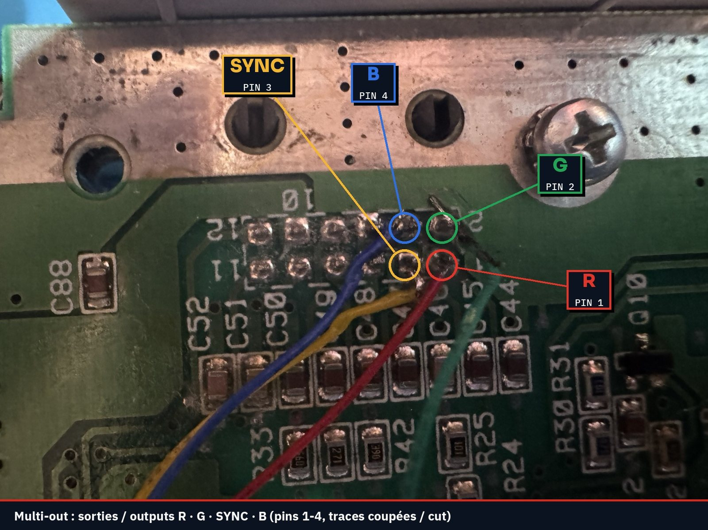
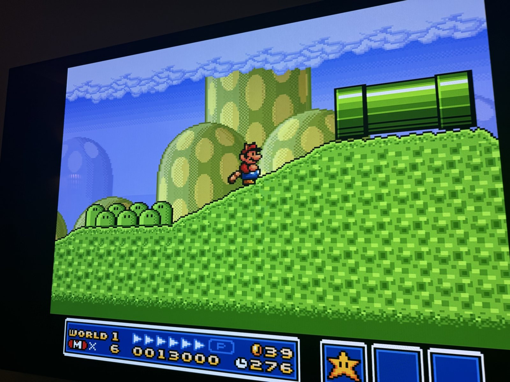

# SNES: installing the RetroSix CleanRGB + EdgeBuster

The original SNES is known for a soft RGB picture, with ghosting on the edges of pixels. The **CleanRGB + EdgeBuster** board from RetroSix fixes both: you get the sharp, stable picture this console deserves.

!!! warning "Check your board revision first"
    The solder points depend on your SNES's **motherboard revision**. This guide shows an **SHVC-CPU-01** board, one of the very first (1990). On another revision the component numbers (Q3, Q5, Q7…) are not the same: follow the RetroSix instructions for your board.

## What it does

- **CleanRGB:** rebuilds the red, green, blue and sync signals properly: correct levels, colour balance and noise filtering.
- **EdgeBuster:** removes the ghosting and blurry edges caused by the SNES's video chips. It is meant for **2-chip** boards (two separate video chips, S-PPU1 and S-PPU2).

## Compatibility by revision

| Board type | Revisions (examples) | CleanRGB | EdgeBuster |
|---|---|---|---|
| **2-chip** | SHVC-CPU-01, SNS-CPU-GPM-01/02, SNS-CPU-RGB-01/02, SNS-CPU-APU-01, SNSP-CPU-01/02 (PAL) | ✅ | ✅ made for these boards |
| **1-chip** | SNS-CPU-1CHIP-01/02/03, SNSP-CPU-1CHIP (PAL) | ✅ | ❌ not needed (already sharp) |
| **SNES Mini / New-Style** | SNN-CPU-01 | ⚠️ needs an RGB mod first | ❌ |

## Identify your revision

Open the console: the revision is printed on the motherboard, next to the Nintendo logo and the year. On a 2-chip board you'll also see **two video chips**, S-PPU1 and S-PPU2.

{ .pn-photo }

## What you need

- The RetroSix **SNES CleanRGB + EdgeBuster** board
- Thin wire (30 AWG), Kapton tape, a hobby knife
- A fine-tip soldering iron and a multimeter
- An RGB cable with **composite sync (csync)** to test

## Wiring map (SHVC-CPU-01)

All the work is done on the **underside** of the motherboard.

| CleanRGB pad | Goes to |
|---|---|
| **5V** | Cartridge slot, **pin 27** |
| **GND** ⏚ | Cartridge slot, **pin 5** |
| **Input R** | **Q3** |
| **Input G** | **Q5** |
| **Input B** | **Q7** |
| **Input S** (sync) | Pad between **Q3 and C69** |
| **Output R** | Multi-out **pin 1** |
| **Output G** | Multi-out **pin 2** |
| **Output S** (csync) | Multi-out **pin 3** |
| **Output B** | Multi-out **pin 4** |

{ .pn-photo }

## RetroSix installation video

The official RetroSix video walks through the installation step by step. Use it alongside the map above.

<iframe src="https://www.youtube-nocookie.com/embed/JLM67N5JXhw" title="RetroSix SNES CleanRGB + EdgeBuster" style="position:absolute;inset:0;width:100%;height:100%;border:0" allow="accelerometer; encrypted-media; gyroscope; picture-in-picture" allowfullscreen></iframe>

[Watch on YouTube :material-open-in-new:](https://www.youtube.com/watch?v=JLM67N5JXhw){ .md-button target=_blank }

## Steps

### 1. Cut the multi-out traces (pins 1 to 4)

On the underside of the multi-out connector, cut the trace leaving each of **pins 1, 2, 3 and 4**. This disconnects the original video signal so only the clean signal reaches the connector. Check with the multimeter that each pin is really isolated.

{ .pn-photo }

### 2. Place the board and power it

Put Kapton tape under the board so nothing touches the motherboard. Connect **5V** to cartridge slot **pin 27** and **GND** to **pin 5**.

{ .pn-photo }

### 3. Wire the inputs

Short wires from the **INPUTS** row to Q3 (R), Q5 (G), Q7 (B) and the sync point between Q3 and C69.

{ .pn-photo }

### 4. Wire the outputs to the multi-out

From the top row of the board (S, R, B, G) to the multi-out pads you isolated: **R → 1, G → 2, S → 3, B → 4**.

{ .pn-photo }

### 5. Enable the EdgeBuster

Bridge the **ENABLE EDGEBUSTER** pads on the board as described in the RetroSix instructions.

### 6. Test before closing

Plug in an RGB cable with **csync**, start a game and check the picture before putting the shell back on.

## Result

{ .pn-photo }

[Buy the CleanRGB + EdgeBuster :material-cart:](https://pixelnet.ca/products/cleanrgb-edgebuster-retrosix-super-nintendo){ .md-button .md-button--primary }

Not comfortable soldering? PixelNet can [install it for you](https://pixelnet.ca/collections/installation). Questions: [support@pixelnet.ca](mailto:support@pixelnet.ca)
